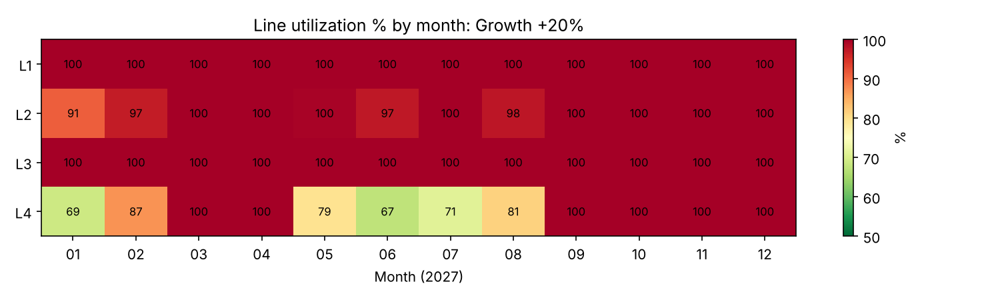

# Plant Capacity Planner

**Can the plant actually deliver the commercial plan?**

Commercial teams set volume targets. Plants have fixed lines, shifts and efficiency. When the two plans are built separately, the gap only shows up when orders go unfilled. This tool connects them: it takes a 12-month demand forecast, assigns production to lines with a linear program and shows where capacity runs out, which products fall short and which investment fixes it.

> All data is **fictional**: a made-up dairy plant with 4 lines and 5 cheese products.



## What it does

1. **Available hours per line:** shifts × hours × days, minus planned maintenance, × OEE.
2. **Optimal production plan (linear program, PuLP):** decides how many kg of each product each line makes each month. First it minimizes unmet demand, then total line hours.
3. **Bottleneck detection with shadow prices:** the dual value of each line's capacity constraint shows how much extra demand one more hour on that line would serve.
4. **What-if scenarios:** demand growth, OEE changes and adding shifts, through a script or an interactive app.

## Key results

| Scenario | Service level | Unmet demand | Bottleneck |
|---|---|---|---|
| Base plan | 99.98% | 5.7 t | L2 |
| Demand +20% | 97.5% | 1,114 t | L2 |
| +20% and 3rd shift on L2 | 98.3% | 772 t | L1 |
| +20% and 3rd shift on L3 | 99.5% | 235 t | L2 |

**Insights**
- At +20% growth the plant misses about 1,100 t, mostly the aged Manchego-style cheese, which only line L3 can make.
- The shadow price ranks L2 as the most valuable line *per extra hour*, because freeing L2 lets the other lines shift products down the chain. But a full extra shift on L3 recovers **about 2.5× more** demand than one on L2 (879 t vs. 342 t). Marginal (per-hour) analysis and full scenarios answer different questions, so a capacity decision should test both.

## Project structure

```
data/generate_data.py   creates the fictional plant data (CSV)
src/capacity.py         capacity model + linear program + summary
run.py                  runs the scenarios, saves charts to outputs/
app.py                  interactive what-if app (Streamlit)
```

## How to run

```bash
pip install -r requirements.txt
python data/generate_data.py   # create the data
python run.py                  # scenarios + charts
streamlit run app.py           # interactive app
```

## Methods

Linear programming (PuLP / CBC) · shadow prices · OEE-based capacity · scenario analysis · Python (pandas, matplotlib) · Streamlit

## Next steps

- Add changeover times between products (mixed-integer model)
- Add cost per hour and margin per kg to choose *which* demand to sacrifice
- Plug in a demand forecast model (Prophet) instead of a fixed forecast
